# ArchShell – architecture-driven AI development shell (design)

> Status: **design draft**. Working name: `archshell`. No code yet.
> Product requirements: [`_bmad-output/initiative-archshell/prd-archshell/prd-archshell.md`](../../_bmad-output/initiative-archshell/prd-archshell/prd-archshell.md).
> Where this README and the PRD disagree, the PRD wins.

ArchShell is a harness that orchestrates agents, skills, and plugins so that AI-generated
code follows an explicit, enforced architecture. The LLM writes code; **templates, contracts,
the compiler, and architecture tests decide whether that code is accepted**.

## 1. Principles

1. **Deterministic process, not deterministic output.** Two runs may produce different code, but
   both pass through the same steps and the same blocking gates.
2. **Architecture is code.** Every rule that matters lives in `architecture.yaml` and becomes a
   failing test when violated. Prose alone is never an enforcement mechanism.
3. **Ask, don't guess.** When the request does not identify the pattern clearly, the shell asks
   discriminating questions, one at a time.
4. **Decisions are written down.** The chosen architecture is recorded once (ADR + charter) and
   every later feature reads it before generating anything.
5. **The pattern is immutable; the charter only grows.** The chosen pattern and its rules never change
   for the life of the project. The charter can only grow within the pattern (new modules or
   contracts), after a human approves it; each growth is recorded in a new, additive ADR, and the
   yaml and the tests are then regenerated.

## 2. Shell architecture (hexagonal)

The shell itself is hexagonal, so phase 2 adds a new driving adapter instead of a rewrite.

```
        ┌──────────────────────── driving adapters ────────────────────────┐
        │ Host adapters (Phase 1)                         │ CLI (Phase 2)  │
        │ claude-code (launch) · codex · gemini · opencode │                │
        └────────────────────────────┬─────────────────────────────────────┘
                                     ▼  engine JSON interface (stdin/stdout)
 ┌──────────────────── core engine (Python, language-agnostic) ────────────────────┐
 │ PatternCatalog  PatternSelector  Elicitor  CharterWriter                        │
 │ Scaffolder      ArchTestGenerator  GateRunner  FeatureWorkflow                  │
 └───────┬──────────────────────┬─────────────────────────────┬────────────────────┘
         ▼                      ▼                             ▼
   LlmProvider port      Filesystem/Git port           LanguagePack port
   anthropic (launch)    (charter, ADRs)                      │
   openai · google ·                              ┌───────────┼─────────────┐
   ollama (future)
                                                  ▼           ▼             ▼
                                            dotnet-csharp   (java)   (typescript) ...
                                            (launch pack)   future packs
```

The core never contains language-specific code. Everything that depends on a language lives in a
**language pack**, so packs can be added or changed without touching the core.

### Solution overview (Phase 1)

```mermaid
flowchart TB
    Dev(["👩‍💻 Developer<br/>(EN / ES)"])

    subgraph Host["Claude Code — host adapter (archshell-claude-code)"]
        Skills["Skills<br/>arch-select · arch-feature · arch-grow"]
        Agents["Agents<br/>arch-elicitor · arch-verifier"]
        Hooks["Hooks<br/>PostToolUse → fast checks<br/>Stop → full gates"]
        AI["AI agent<br/>(own GitHub identity, no admin)"]
    end

    subgraph Core["archshell-core — Python engine (language/host/vendor agnostic)"]
        Catalog["PatternCatalog<br/>18 pattern cards"]
        Selector["PatternSelector<br/>deterministic scoring"]
        Elicitor["Elicitor<br/>≤ 5 plain-language questions"]
        Charter["CharterWriter"]
        Scaffolder["Scaffolder"]
        TestGen["ArchTestGenerator"]
        Gates["GateRunner"]
        Workflow["FeatureWorkflow<br/>spec → RED → implement → gates<br/>max 5 attempts"]
    end

    subgraph Pack["archshell-dotnet — language pack (.NET 10)"]
        Templates["Templates<br/>18 patterns + 3 combinations"]
        NetTests["NetArchTest / ArchUnitNET<br/>contract tests"]
        Build["dotnet build -warnaserror<br/>dotnet test"]
    end

    subgraph Repo["Developer's new project (Git repo)"]
        ADR["docs/adr/0001 + growth ADRs"]
        ArchMd["ARCHITECTURE.md"]
        Yaml["architecture.yaml<br/>(source of truth)"]
        Code["Solution + projects<br/>(ProjectReferences wired)"]
        ArchTests["tests/Architecture.Tests<br/>(generated, protected)"]
        Owners["CODEOWNERS"]
        CIfile[".github/workflows/archshell.yml"]
    end

    subgraph GitHub["GitHub — outside the agent's reach"]
        Verify["archshell verify<br/>no LLM · deterministic"]
        Protect["Branch protection<br/>+ human PR approval"]
    end

    Dev -->|request| Skills
    Skills --> Selector
    Catalog --> Selector
    Selector -->|low confidence| Elicitor
    Elicitor -->|question| Dev
    Selector -->|proposal + tradeoffs| Dev
    Dev -->|confirm| Charter

    Charter -->|atomic with scaffold| ADR & ArchMd & Yaml
    Charter --> Scaffolder
    Scaffolder --> Templates
    Templates --> Code
    TestGen --> NetTests --> ArchTests
    Yaml --> TestGen
    Scaffolder --> Owners & CIfile

    Dev -->|feature| Workflow
    Workflow --> AI
    AI -->|edits| Code
    Hooks --> Gates
    Gates --> Build
    Gates -->|fail| AI
    Workflow -->|needs module| Dev
    Dev -->|approve growth| Yaml

    Repo -->|push / PR| Verify
    Verify --> Protect
    Protect -->|CODEOWNERS approval| Dev
```



The diagram shows four flows:
1. **Selection:** the request is scored against the catalog; when confidence is low, the Elicitor asks
   the developer; the developer confirms the proposal.
2. **Charter + scaffold (one atomic operation):** the ADR, `ARCHITECTURE.md`, and `architecture.yaml`
   are written, the project is scaffolded from templates, and architecture tests are generated from the yaml.
3. **Features:** the agent edits code, hooks trigger the gates, failures go back to the agent (max 5
   attempts), and any charter growth needs developer approval.
4. **External control:** every push or pull request runs `archshell verify` in CI, and charter changes
   need human approval through `CODEOWNERS`. The agent cannot reach this layer.

### Language pack contract

A language pack implements the `LanguagePack` port:

| Capability | .NET/C# pack (launch) |
|---|---|
| `scaffold(pattern, charter)` | `dotnet new` templates per pattern (solution, projects, folders) |
| `wire_dependencies(charter)` | `.csproj` `ProjectReference`s that match `may_depend_on` |
| `generate_arch_tests(charter)` | NetArchTest / ArchUnitNET test project |
| `generate_contract_tests(charter)` | OpenAPI conformance tests |
| `gates()` | `dotnet build -warnaserror`, `dotnet test` (architecture, contract, unit) |
| `naming(rule)` | C# naming conventions (PascalCase types, `I` prefix for interfaces) |
| `supported_patterns()` | Patterns with a template in this pack |
| `block_map(pattern)` | Intent-to-building-block mapping table per pattern |
| `scaffold_feature(plan)` | Building-block templates (handler, port, adapter, endpoint, entity, tests) |
| `generate_contracts(plan)` | C# interfaces, records, and the OpenAPI fragment from contract data |
| `diff_public_contracts(old, new)` | `PublicApiAnalyzers` surface + OpenAPI diff (breaking changes) |
| `diff_surface(plan, code)` | Roslyn comparison of planned vs. actual members and signatures |
| `generate_composition(plans)` | DI registration and endpoint mapping; migrations via `dotnet ef migrations add` |
| `generate_policies(plans)` | Policy file read by the cross-cutting pipeline (MediatR behaviors or middleware) |
| `inflections()` | Fixed, versioned singular/plural table for name normalization |

Packs are discovered as Python entry points (`archshell.language_packs`). Each pack declares the
contract version it implements, and the core refuses packs with an incompatible version.
`architecture.yaml` stays language-neutral except for its `language:` field.

### Host and model contracts

The core knows neither the agent runtime it runs inside nor the model vendor. Two separate extension
points keep it that way:

| Extension point | What varies | Launch | Future |
|---|---|---|---|
| **Host adapter** | Where the shell runs: plugin format, skill/agent files, hook events, question UI | `claude-code` | `codex`, `gemini-cli`, `opencode` |
| **`LlmProvider`** | Which model API the CLI calls directly | `anthropic` | `openai`, `google`, `ollama` |

**Host adapter.** All workflow logic lives in the Python engine and is exposed through a stable,
versioned JSON interface (`archshell-engine <command>`, JSON in on stdin, JSON out on stdout). A host
adapter is a thin translation layer:
- It renders host-native skills, agents, and hooks from core-owned prompt templates. Prompts are
  owned by the core and written once; adapters only change the packaging.
- It maps host events (for example `PostToolUse`, `Stop`) to engine commands (`verify`, `gate`).
- It maps the engine's `ask_user` result to the host's question UI.

**`LlmProvider` port.** It is used when the engine itself needs a model (the Phase 2 CLI, or a host
without a native agent). It is implemented with three capabilities:

```python
class LlmProvider(Protocol):
    contract_version: str
    def complete_structured(self, prompt: Prompt, schema: JsonSchema) -> dict: ...
    def capabilities(self) -> ProviderCapabilities: ...   # context window, native JSON mode, tools
```

**Rules that keep the core vendor-neutral:**
1. Every LLM output is validated against a JSON Schema owned by the core. Invalid output gets a
   bounded retry, then becomes an error. It is never repaired by guessing.
2. Vendor-specific prompting (JSON mode, tool calling, system prompt placement) lives in the adapter,
   never in the core.
3. **Conformance gate:** a new provider or host is enabled only after it passes the D3 golden set and
   the engine contract tests with the same thresholds as the launch pair. Switching models changes
   extraction quality, so the golden set is what proves equivalence.
4. Adapters and providers are discovered as Python entry points (`archshell.hosts`,
   `archshell.providers`) and declare the contract version they implement.

| Component | Responsibility |
|---|---|
| `PatternCatalog` | Loads one **pattern card** per pattern, built from `02-ARQUITECTURA/*` |
| `PatternSelector` | Extracts drivers from the request and scores the cards; returns candidates plus confidence |
| `Elicitor` | When confidence is low or the top candidates tie, picks the question that best separates them |
| `CharterWriter` | Writes the ADR, `ARCHITECTURE.md`, and `architecture.yaml` |
| `Scaffolder` | Delegates to the active language pack's templates (the LLM never decides structure) |
| `ArchTestGenerator` | Delegates to the language pack to generate architecture tests from `architecture.yaml` |
| `GateRunner` | Runs the language pack's gates (build, architecture, contract, unit); any failure blocks |
| `FeatureWorkflow` | Runs the per-feature flow (section 5) |

## 3. Pattern selection

### Pattern card

```yaml
pattern: cqrs
provenance: 02-ARQUITECTURA/CQRS   # authoring source only; never read at runtime
signals: [reads far exceed writes, distinct read models, heavy reporting]
anti_signals: [simple CRUD, small team, thin domain]
combines_with: [ddd, event-sourcing, clean]
excludes: []
discriminators:
  - "Do reads need a different shape than the data being written?"
```

**`02-ARQUITECTURA` is an authoring source, not a runtime dependency.** When the shell is built,
its guides are distilled into pattern cards (shipped in `archshell-core/catalog/`), and its .NET
samples become the `dotnet-csharp` pack templates and golden-set cases. At runtime the shell reads
only what ships inside its plugins, so it works in any repository. Teams can add their own cards
through an optional, configured extra catalog path.

Launch catalog (authored from `02-ARQUITECTURA`): Layered, MVC-MVVM, Clean, Clean-Screaming, Screaming, Hexagonal,
Onion, DDD, CQRS, Event-Sourcing, Event-Driven, Vertical-Slice, Modular-Monolith, Microkernel,
Pipes-and-Filters, Microservices, Serverless, Frontend.

### Algorithm

1. Extract drivers from the request: domain complexity, scale, audit needs, read/write asymmetry,
   deployment model, team size, and integrations.
2. Score every card (signals add, anti-signals subtract).
3. If the top score is under the confidence threshold, or the gap to the runner-up is small, the
   `Elicitor` asks the discriminator that best splits the top candidates. It asks **one question,
   then stops** and repeats the loop with the answer.
4. Resolve compatible combinations (for example *Modular-Monolith + Vertical-Slice per module*, or
   *Clean + Screaming + CQRS*) using `combines_with`/`excludes`.
5. The user confirms the proposal before anything is written.

### 3.1 Decision policy (D3)

**Determinism boundary.** The LLM only extracts drivers into a closed schema; it never scores
patterns. Unknown information must be recorded as `unknown`, never guessed. Python scores the
drivers against the pattern cards, so the same drivers always produce the same score.

```yaml
domain_complexity: high        # low | medium | high | unknown
read_write_asymmetry: unknown
audit_trail: required
deployment: single_unit
```

**Auto-proposal** requires **all** of the following:

| Condition | Initial value | Prevents |
|---|---|---|
| Top candidate score | >= 0.75 | Choosing without enough evidence |
| Margin over runner-up | >= 0.15 | Ties disguised as certainty |
| Critical drivers still `unknown` | 0 | Deciding on gaps |
| Combination validity | no `excludes` conflict | Incoherent pattern mixes |

**Question selection.** The next question targets the `unknown` driver with the highest information
gain: the one where the top candidates differ the most. Questions about drivers that do not separate
the candidates are never asked.

**Budget and fallback.**
- At most 5 questions per selection.
- If the budget runs out below threshold, the shell never chooses on its own: it presents the top two
  candidates with their tradeoffs, and the user decides. The ADR records this as a human decision.
- Even above threshold, the user confirms the proposal before the charter is written.

**Calibration.** The values above are initial. They are tuned against a golden set of 15–20
requests with expected patterns (derived from `02-ARQUITECTURA/*/sample`). The evaluation tracks
correct selections, unnecessary questions, and wrong selections. Wrong selections are the costly
error, so tuning is biased toward asking.

## 4. The architecture charter (persisted)

| Artifact | Audience | Content |
|---|---|---|
| `docs/adr/0001-architecture.md` | Humans | Chosen pattern(s), drivers, rejected alternatives and why |
| `ARCHITECTURE.md` | Humans + LLM | Layers, responsibilities, rules in prose, examples |
| `architecture.yaml` | Gates (source of truth) | Layers, allowed dependencies, naming, port and contract locations |
| `tests/Architecture.Tests/` | Compiler / CI | Tests generated from `architecture.yaml`; never hand-edited |

```yaml
# architecture.yaml (sketch)
version: 1
language: dotnet-csharp
adr: docs/adr/0001-architecture.md
patterns: [clean, screaming]
modules: [Appointments, Billing, Patients]          # screaming: top level = business capability
layers:
  - { name: Domain,      project: "{Module}.Domain",      may_depend_on: [] }
  - { name: Application, project: "{Module}.Application", may_depend_on: [Domain] }
  - { name: Adapters,    project: "{Module}.Adapters",    may_depend_on: [Application, Domain] }
rules:
  - id: ports-live-in-application
    interfaces_matching: "I*Repository|I*Gateway"
    must_reside_in: Application
  - id: no-cross-module-internals
    modules_may_reference_only: [SharedKernel, "{Other}.Contracts"]
naming:
  use_case: "{Verb}{Noun}Handler"
contracts:
  http: contracts/openapi.yaml
```

Tamper protection: changes to `architecture.yaml`, the generated tests, `<ProjectReference>`s, gate
build settings (for example `Directory.Build.props`), test project inclusion, or hook configuration
that do not come from an approved charter growth are blocked. The hooks catch them early in the
session; `archshell verify` in CI is the authoritative check, because the agent cannot reach it.
`CODEOWNERS` assigns the charter files to human owners, and the agent works under its own GitHub
identity without admin rights, so a human always approves charter changes.

Enforcement layers, from strongest to weakest:
1. **Project references**: a forbidden dependency does not compile.
2. **Generated architecture tests**: naming, port location, and cross-module rules.
3. **Contract tests**: implementations conform to the published OpenAPI/JSON Schema.
4. **Prose in `ARCHITECTURE.md`**: guidance for the LLM only, never the last line of defense.

## 5. Per-feature workflow

```
bootstrap (once): charter + scaffold + feature backlog, atomically; no business code

per feature:
read charter → spec (S1..Sn) → ask if gaps → LLM labels intents or policies + tokens (x3 consensus)
→ engine derives feature plan (growth proposed first if needed) + LLM proposes contracts as data
→ one confirmation, only of new business decisions (none needed if fully derived)
→ engine scaffolds blocks, contracts, composition, and policies atomically (byte-identical) → contracts frozen
→ RED test → LLM fills bodies + private members → gates (build, arch, contract, unit, plan + surface conformance)
→ fail = reject and retry (max 5 attempts per spec item) | pass = done
```

- **Confirmation records:** every confirmation (growth, vocabulary, plan, extension, contract revision,
  breaking change) writes a committed record under `CODEOWNERS`; the pull request review is the real
  approval, and `archshell verify` fails on a protected change without a matching record.
- **Confirm only new decisions:** the developer is asked only about new vocabulary terms, charter growth,
  new or changed public contracts, and breaking changes; derived structure is shown collapsed.
- **Domain vocabulary:** protected list of nouns and verbs that every generated name comes from; a new
  term triggers an explicit synonym question.
- **Plan extension:** the agent may only reclassify or add a spec item, with a cited reason; the engine
  re-derives, the developer confirms the delta; at most 2 per spec item, each counts as an attempt.
- **Surface and composition:** the plan fixes each type's members and signatures (agent adds only
  private members); DI, endpoint, and policy files are generated and protected.
- **Policies:** authorization, audit, and transaction rules are data in the policy file, applied by
  the template's pipeline, never written in method bodies.
- **Breaking changes:** compared against the merge base; the additive (expand/contract) version is
  offered first; if declined, every consumer becomes a consumer-adaptation block in the plan.

- **Feature plan:** the model only labels each spec item with intents from a closed set plus
  verb/noun tokens; the pack's mapping table, the naming rules, and an existing-block check derive
  the building blocks. Disagreement across the 3 classification runs becomes a question. The plan is
  stored at `features/<id>/plan.yaml` and protected; the per-edit check blocks files outside it.
- **Contracts:** proposed as data (closed type set, existing types reused), rendered by the pack,
  confirmed in plain language, and frozen before RED. Breaking changes to public contracts need a
  recorded confirmation, enforced by the gates and `archshell verify`.
- **Backlog:** `docs/feature-backlog.md` holds the capabilities of the initial request per module;
  each item runs this workflow.

- **Gate timing:** fast checks (dependency and naming rules) run after every edit; the full gates
  run when the agent reports a task done and whenever the session stops.
- **Charter growth:** if a feature needs a module or contract location the charter does not
  declare, the shell proposes the growth before showing the plan and applies it only after the developer confirms (and, in CI, after the
  charter owners approve the pull request).
- **Misfit:** if a feature only fits by changing the pattern, the shell stops after the 5th attempt
  with a report (failing rule, what the agent tried, best guess why). It never changes or relaxes a
  rule; the developer reshapes the feature.

## 6. Phases

### Phase 1 – Claude Code plugin

```
archshell-core/                 # Python engine: host-, vendor-, and language-agnostic
  engine/                       # scoring, D3 policy, charter, workflow, ports
  prompts/                      # core-owned prompt templates (select, elicit, feature, grow)
  schemas/                      # JSON Schemas for every LLM output and engine command
  catalog/                      # pattern cards
  golden/                       # D3 golden set + conformance tests

archshell-claude-code/          # host adapter (launch)
  .claude-plugin/plugin.json
  skills/                       # rendered from prompts/: arch-select, arch-feature, arch-grow
  agents/                       # arch-elicitor, arch-verifier
  hooks/hooks.json              # PostToolUse -> fast checks; Stop -> full gates; block on failure

archshell-dotnet/               # language pack plugin: .NET / C#
  .claude-plugin/plugin.json
  pack/                         # Python LanguagePack implementation (entry point)
  templates/                    # dotnet new templates: 18 patterns + 3 combinations
  skills/dotnet-conventions/SKILL.md
```

Phase 1 also ships `archshell verify`: a deterministic CI check (no model) that runs on every push
and pull request. ArchShell generates the CI workflow and `CODEOWNERS` file for the project.

Launch templates cover the 18 catalog patterns plus three combinations: Clean + Screaming,
Clean + Screaming + CQRS, and Modular Monolith + Vertical Slice. Any other combination stops before
scaffolding with a gap report.

Installing a language means installing its pack plugin, and supporting a new agent runtime means
adding a host adapter. In both cases the core does not change.

Exit criteria:
- Given three sample requests, it selects the expected pattern(s) or asks a discriminating question.
- It writes the ADR, `ARCHITECTURE.md`, `architecture.yaml`, and generated architecture tests.
- The gates detect 100% of a seeded-violation corpus (features written on purpose to break each
  rule type, including plan, surface, record, composition, and breaking-change violations) for every
  shipped template.
- Every one of the 21 templates ships the full feature workflow; a reference feature per intent runs
  end to end on each.

### Phase 2 – Standalone CLI

- A new driving adapter (`archshell select | feature | grow`) over the **same core engine**.
  `archshell verify` already ships in Phase 1.
- The engine calls a model directly through an `LlmProvider` plugin (`anthropic` at launch), selected
  in configuration (`archshell --provider openai`).

## 7. Decisions

| ID | Decision | Status |
|---|---|---|
| D1 | Core engine language | **Decided**: Python |
| D2 | Target stacks at launch | **Decided**: .NET/C# only (.NET 10 LTS or later), via the `dotnet-csharp` language pack; other languages are added as new packs |
| D3 | Confidence threshold and question budget | **Decided**: see section 3.1 (initial values, calibrated with a golden set) |
| D4 | Language-specific code location | **Decided**: one plugin per language; the core stays language-agnostic |
| D5 | Agent runtime and model vendor | **Decided**: host adapters and `LlmProvider` plugins; Claude Code + Anthropic at launch, with Codex, Gemini, and others added without core changes |
| D6 | Changing the architecture | **Decided**: the pattern and its rules are immutable; the charter only grows within the pattern, with human approval |
| D7 | Trust anchor | **Decided**: `archshell verify` in CI ships in Phase 1, with `CODEOWNERS` and a separate agent GitHub identity |
| D8 | Project scope | **Decided**: new (greenfield) projects only |
| D9 | Distribution | **Decided**: open source; the community contributes packs, adapters, and providers |
| D10 | Language | **Decided**: the conversation follows the user (English or Spanish); all generated code and docs are in English |
| D11 | Feature structure | **Decided**: intents (closed set, 3-run consensus) + pack mapping table derive a confirmed, protected feature plan; scaffolding is template-only |
| D12 | Contracts | **Decided**: proposed as data, generated by the pack, confirmed in plain language, frozen before RED; breaking-change check on public contracts |
| D13 | Initial request | **Decided**: bootstrap writes no business code; capabilities become an editable feature backlog |
| D14 | Trust anchor for feature artifacts | **Decided**: committed confirmation records under `CODEOWNERS`; PR approval is authoritative |
| D15 | Confirmation burden | **Decided**: confirm only new business decisions, at most one confirmation per feature |
| D16 | Names | **Decided**: protected domain vocabulary plus a versioned inflection table; synonymy is always asked |
| D17 | Cross-cutting rules | **Decided**: policies as data (`authorization`, `audit`, `transaction`) applied by the template pipeline |
| D18 | Launch breadth | **Decided**: all 21 templates ship the full feature workflow; an intent may be declared not applicable per pattern |
