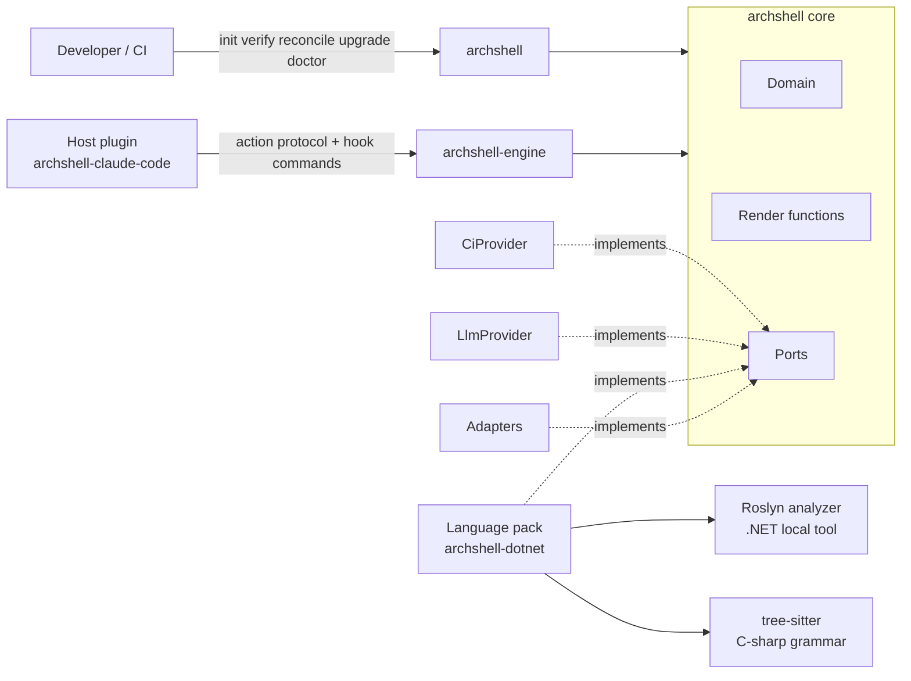
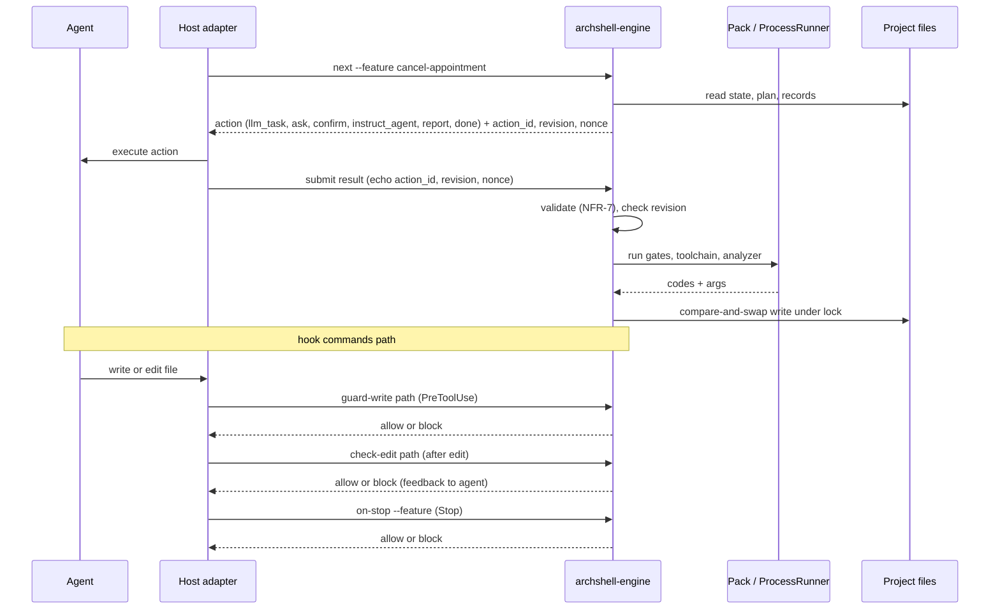
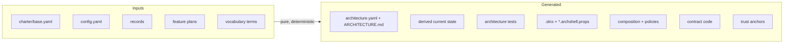

# Architecture Spine — ArchShell

## Design Paradigm

**Hexagonal core** (ports and adapters) with a **functional core / imperative shell** inside it. The engine is a **stateless state machine** driven over a closed action protocol. The core ships **two executables**: `archshell-engine` (action protocol and hook commands, for hosts) and `archshell` (human and CI commands: `init`, `verify`, `reconcile`, `upgrade`, `doctor`).

| Layer | Lives in | Contains |
| --- | --- | --- |
| Domain (pure) | `archshell-core/archshell/domain/` | scoring, D3 policy, workflow state machine, plan derivation, identity and lineage, contract and surface model, rendering |
| Render functions (pure) | `archshell-core/archshell/render/` | host renderers keyed by host id, trust-anchor renderers (AD-21) |
| Ports | `archshell-core/archshell/ports/` | `LanguagePack`, `LlmProvider`, `CiProvider`, `FileStore`, `VcsReader`, `ProcessRunner`, `Clock` |
| Adapters (IO) | `archshell-core/archshell/adapters/` | filesystem with lock and compare-and-swap, read-only VCS, subprocess, clock, canonical YAML/JSON emitter |
| Engine (driving) | `archshell-core/archshell/engine/` | `archshell-engine`: `next`, `submit`, `guard-write`, `check-edit`, `on-stop` |
| Human/CI CLI (driving) | `archshell-core/archshell/cli/` | `archshell`: `init`, `verify`, `reconcile`, `upgrade`, `doctor` |
| Extensions | separate packages | `archshell-dotnet` (pack), `archshell-claude-code` (host plugin, no logic), LLM providers, CI providers |



## Invariants & Rules

### AD-1 — Engine is a stateless state machine

- **Binds:** engine, every host adapter, Phase 2 CLI; FR-23–FR-28, FR-24 resume, FR-26, FR-54
- **Prevents:** each host reimplementing or holding part of the workflow differently; agents resetting attempt bounds
- **Rule:** All workflow state lives in project files. Bounding counters (attempts per S#, extensions, contract revisions) are committed in the protected progress section of the feature plan, and `verify` checks them against the FR-26/FR-54 bounds. Only cursor state (phase, pending action) is gitignored and reconstructible. Each engine command reads state from disk and returns the next action. Hosts execute returned actions and never hold, derive, or skip workflow state.

### AD-2 — Closed engine–host action protocol `archshell/action/v1`

- **Binds:** engine, host adapters, CLI, providers; FR-34, FR-35, FR-39
- **Prevents:** hosts interpreting "ask the user", model calls, or toolchain runs differently; stale or forged submissions
- **Rule:** The action set is closed and versioned: `llm_task`, `ask`, `confirm`, `instruct_agent`, `report`, `done`. There is no `run` action: the toolchain runs only inside the engine through `ProcessRunner`. Loop: `archshell-engine next --feature <slug>` → host executes → `archshell-engine submit` → until `done` or `report`. Every action carries `action_id` and the state `revision`; every `ask`/`confirm` also carries a `nonce`. `submit` echoes them (AD-18, AD-20). The hook commands `guard-write`, `check-edit`, `on-stop` are a separate sub-protocol (AD-17). Hosts never reinterpret an action. All user-facing text comes from the engine. An unsupported action is a typed error. In Phase 1 the host's agent executes `llm_task`; in Phase 2 an `LlmProvider` does, with the engine unchanged.



### AD-3 — Isolated model tasks; consensus batch

- **Binds:** host adapters, providers, engine; FR-44
- **Prevents:** correlated consensus runs that copy each other; paraphrased prompts
- **Rule:** Each `llm_task` executes in a separate context with no shared history. Consensus is one batch of three `llm_task` actions with distinct `action_id`s. In Claude Code each runs in a named plugin agent (not a fork), with the engine prompt passed by file path and never paraphrased. Results are held unpersisted until the batch closes. A conformance test covers this.

### AD-4 — Functional core, imperative shell

- **Binds:** `archshell-core/archshell/domain/`, `archshell-core/archshell/render/`; NFR-4
- **Prevents:** hidden nondeterminism (clock, ordering, floats, Unicode, environment) breaking byte-identical output
- **Rule:** Domain and render code do no IO and never read the clock, randomness, or the environment. Any timestamp is an explicit input stored in the artifact and reused on regeneration. Every collection written out is sorted by an explicit codepoint-ordered key, and file listings are sorted before use. Scoring uses `Decimal` or scaled integers, never `float`. Enforced by an import-linter contract (domain may import only a stdlib allow-list, `decimal`, and `archshell.domain`) and by a CI job that runs the generation suite on Windows, Linux, and macOS and compares bytes.

### AD-5 — Single generation engine and normalizer

- **Binds:** core, every language pack; FR-15, FR-18, FR-24, FR-32, FR-48, FR-57, FR-60
- **Prevents:** two definitions of a module (bootstrap vs. growth); whitespace, line-ending, and Unicode drift across OS
- **Rule:** Jinja2 with `StrictUndefined` renders every generated-class and seeded-class file (AD-16), including `.slnx`, `*.archshell.props`, modules added by growth, building blocks, contracts, composition, policies, and architecture tests. All output passes through the core normalizer: LF, UTF-8 without BOM, NFC, final newline. No formatter ever runs on generated files. The .NET SDK runs only through `ProcessRunner` (restore, build, test, `ef migrations add`); its outputs are toolchain-owned files (AD-16).

### AD-6 — Inputs versus derived artifacts

- **Binds:** core, packs, `verify`, `reconcile`; FR-41, NFR-4, PRD Open Question 1
- **Prevents:** hand-merged generated files and branch conflicts in shared files
- **Rule:** The canonical inputs are the input-class files (AD-16): base charter, config, confirmation records, feature plans, and vocabulary terms. Every generated-class artifact is a pure function of the union of those inputs and is byte-compared by `verify`. Inputs are stored one file per slug, record, or term. Generated files are never merged by hand: on a conflict, take either side and run `archshell reconcile`, which regenerates them from the union of inputs.



### AD-7 — Semantic conflicts: decision at merge base wins

- **Binds:** `reconcile`, `verify`, feature workflow; FR-29, FR-50, FR-51, FR-54, FR-58
- **Prevents:** silent last-writer-wins on module names, member signatures, contracts, synonyms, or slugs
- **Rule:** When two branches make incompatible decisions (the same identity key modified by two plans on the same base fingerprint, the same module name with different content, incompatible changes to one contract, conflicting synonym decisions, or a slug collision), the decision present at `merge-base(HEAD, default)` wins. `reconcile` stops, and the later feature re-derives through the normal flow: plan extension, contract revision, or breaking-change confirmation. On a slug collision `reconcile` renames the later feature to the next suffix and re-derives. A conflict already on the default branch fails `verify` with `post_merge_semantic_conflict`; there is no automatic winner. Contract freeze is per feature branch. The default branch is recorded in `config.yaml` at bootstrap (`origin/HEAD` when present, else `main`).

### AD-8 — Atomicity

- **Binds:** engine; FR-15a, FR-24
- **Prevents:** partial projects after an interrupted bootstrap; half-applied plans
- **Rule:**
  - **Bootstrap:** render and validate everything before writing, and record the writes and backups in `.archshell/txn.json`. A journal found at start means the bootstrap was interrupted, and it is rolled back.
  - **Feature generation:** rolls forward. The confirmed plan is the source of truth, and deterministic regeneration completes the step.

### AD-9 — VCS access is read-only

- **Binds:** engine, CLI, adapters; FR-41, FR-51
- **Prevents:** the engine clobbering a developer's uncommitted work
- **Rule:** The engine never runs mutating VCS commands (commit, stash, reset, checkout, merge). `VcsReader` is the only VCS path and allows exactly: `merge-base`, `merge-base --is-ancestor`, `rev-parse`, `show <rev>:<path>`, `ls-files`. Bootstrap requires a git repository. No merge base means an empty baseline.

### AD-10 — Project file layout

- **Binds:** core, packs, hosts, CI providers, `CODEOWNERS`; FR-14, FR-52, FR-53, FR-58
- **Prevents:** per-pack layouts; agents resetting attempts or editing records; branch collisions on IDs
- **Rule:** The core owns the layout below; each path has exactly one ownership class (AD-16). Only the engine writes under `.archshell/`, and `guard-write` blocks every agent write there. A feature ID is a kebab-case slug, never a sequential number; a duplicate slug gets a suffix and a notice. Records are append-only at `records/<feature-slug>/<seq>-<flow>.yaml`, `seq` zero-padded per feature, `flow` from the closed vocabulary `plan`, `extension`, `contract`, `contract-revision`, `breaking-change`, `growth`, `vocabulary`. Growth belongs to the triggering feature; bootstrap uses slug `bootstrap`. Guard and `verify` reject record edits. Bounding counters are committed in the plan; only cursor state is gitignored.

```text
architecture.yaml                          # generated: charter view
ARCHITECTURE.md                            # generated
docs/adr/architecture.md                   # human-owned prose (AD-23)
docs/adr/growth-<slug>.md                  # human-owned prose (AD-23)
docs/feature-backlog.md                    # human-owned
global.json                                # generated, trust anchor
.config/dotnet-tools.json                  # generated, trust anchor
.gitattributes                             # generated, trust anchor
<ci owners file>, <ci workflow>            # generated by CiProvider, trust anchor
<host hook config>                         # generated by host renderer, trust anchor
src/**/*.csproj                            # seeded; imports generated *.archshell.props
.archshell/                                # engine-only; one CODEOWNERS glob
  config.yaml                              # input, protected
  trust.yaml                               # generated, protected
  charter/base.yaml                        # input, protected
  vocabulary/<term>.yaml                   # input, protected
  features/<slug>/plan.yaml                # input, protected; committed counters
  records/<feature-slug>/<seq>-<flow>.yaml # input, append-only
  derived/*.yaml                           # generated: current state per identity
  policies.yaml                            # generated
  state/<slug>.yaml                        # gitignored: cursor only
  locks/<slug>.lock                        # gitignored
  txn.json                                 # gitignored, bootstrap only
```

### AD-11 — Core owns every ArchShell schema and the surface model

- **Binds:** core, all extensions; FR-36, FR-47, NFR-7
- **Prevents:** packs or hosts inventing file or message formats; language-specific contract data
- **Rule:**
  - **Schemas:** every ArchShell file and protocol message declares `schema: archshell/<kind>/v<n>` and is validated with JSON Schema draft 2020-12 from `archshell-core/schemas/`.
  - **YAML:** a restricted subset (no anchors, aliases, or tags, read with a safe loader), written only by the core's canonical emitter.
  - **Versioning:** an added optional field keeps the version. Any other change bumps `v<n>` and ships an idempotent migration that `archshell upgrade` runs.
  - **Surface model:** language-neutral, in core schema. Member kinds `operation`, `field`, `constructor`; visibility `public`, `module`, `private`; types from the FR-47 closed type system. Each pack declares its construct mapping in its conformance manifest and owns comparison.
  - **Packs:** never define ArchShell formats. They emit language artifacts at charter-derived paths. Pack and analyzer payloads are never persisted in ArchShell files.

### AD-12 — Two-tier C# analysis, Roslyn authoritative

- **Binds:** `archshell-dotnet`; FR-20, FR-46, FR-51, FR-56, NFR-1
- **Prevents:** per-edit latency over budget, or fast checks approving what the full gates reject
- **Rule:**
  - **Per-edit checks:** syntactic, using tree-sitter with the C# grammar from Python. Any `ERROR` or `MISSING` node means unsure and defers to the full gates. The pack records the grammar's language-version ceiling; the golden corpus includes C# 14 samples.
  - **Full gates and `verify`:** use the Roslyn analyzer, a `net10.0` .NET local tool running `MSBuildWorkspace` with the Roslyn of the SDK band pinned in generated `global.json`, located through `MSBuildLocator`, `RollForward=LatestMajor`. One batch invocation per run (surface, types per file, consumers), a JSON envelope defined by the core and a payload defined by the pack, read-only.
  - **Authority:** Roslyn's verdict is authoritative. The syntactic tier may over-block but never approves what Roslyn would reject.

### AD-13 — Breaking changes compare contract data

- **Binds:** core, pack; FR-47–FR-51
- **Prevents:** tool-dependent or build-dependent breaking-change verdicts
- **Rule:** Breaking-change detection diffs the contract data in feature plans (surface model, AD-11; identity keys, AD-19), not compiled code. The baseline is the plans at `merge-base(HEAD, default)`, read through `VcsReader`. The engine computes the verdict (AD-18). Roslyn is used only to find consumers for consumer-adaptation blocks. No PublicApiAnalyzers or OpenAPI diff.

### AD-14 — Distribution, pinning, and explicit upgrade

- **Binds:** distribution, `verify`, `upgrade`, all extensions; FR-36, FR-41
- **Prevents:** a new pack or template version breaking `verify` on existing projects overnight; incompatible extensions loading
- **Rule:**
  - **Install:** `uv tool install archshell --with archshell-dotnet` (or the `archshell[dotnet]` extra). CI runs `uvx --from archshell==X --with archshell-dotnet==Y`. The Roslyn analyzer ships on NuGet, pinned in `.config/dotnet-tools.json`.
  - **Extension contract:** each extension's entry-point object exposes `extension_contract = archshell/<kind>-ext/v<n>`; the core checks it at load and refuses with a typed error. Two packs claiming one language: refuse to start with a typed error.
  - **Pinning:** `architecture.yaml` records the core and pack versions, and `verify` installs exactly those. The engine and `verify` refuse inputs whose schema version differs from the pinned core and point to `archshell upgrade`.
  - **Upgrades:** only through `archshell upgrade`, which runs migrations, writes regenerated generated-class files to the working tree, never touches seeded files, and prints commit/PR instructions. Never silent.
  - **Host plugin:** holds no logic. It checks the action protocol version at start and stops with upgrade instructions on a mismatch.

### AD-15 — CI behind a port; trust capability recorded

- **Binds:** `verify`, `init`, `doctor`, CI providers; FR-30, FR-41, FR-53, NFR-5
- **Prevents:** a CI-specific `verify`; claiming a trust anchor the platform cannot enforce; network use in `verify`
- **Rule:**
  - **`verify`:** provider-agnostic. It reports through its exit code and an `archshell/error/v1` report.
  - **Provider-specific output** (workflow file, owners file, setup docs) is rendered by `CiProvider` (entry point `archshell.ci`). GitHub ships at launch. A provider is supported only if it can require owner approval by path.
  - **Capability:** `init` detects whether owner review can be enforced and records it in `.archshell/trust.yaml` (generated, protected). `verify` reads it offline and, when unenforced, reports `trust: unenforced` on every run. `archshell doctor` optionally re-checks with network.

### AD-16 — File ownership classes

- **Binds:** core, packs, hosts, CI providers, `verify`, `upgrade`, `reconcile`; FR-15, FR-41, FR-52, FR-57
- **Prevents:** two writers for one path; regeneration clobbering agent code; mixed files with no owner
- **Rule:** Every path belongs to exactly one class with exactly one writer. A mixed `.csproj` is seeded; ArchShell owns only an imported generated `*.archshell.props`.

| Class | Examples | Writer | How `verify` checks it |
| --- | --- | --- | --- |
| input | `.archshell/charter/base.yaml`, `config.yaml`, records, plans, vocabulary terms | engine, via confirmation flows | schema validation; records append-only; counters within bounds |
| generated | arch tests, contract code, composition, policies, `.slnx`, `*.archshell.props`, `derived/*.yaml`, `trust.yaml`, owners file, CI workflow, hook config, `.gitattributes`, `dotnet-tools.json`, `global.json`, `architecture.yaml`, `ARCHITECTURE.md` | core render pipeline | regenerate from inputs and byte-compare |
| seeded | building-block bodies, `.csproj`, module scaffold | template once, then the agent within the planned surface | surface and plan conformance; never regenerated |
| toolchain-owned | EF Core migrations | `ProcessRunner` once, with plan-fixed name and stored timestamp | existence and build; never regenerated |
| human-owned | `docs/feature-backlog.md`, ADR prose | humans | none beyond existence |

### AD-17 — Hook sub-protocol

- **Binds:** engine, host adapters; FR-20, FR-52, FR-53, NFR-1
- **Prevents:** protected sets drifting into host config; hooks that cannot block
- **Rule:** The engine exposes `guard-write <path>`, `check-edit <path>`, and `on-stop --feature <slug>`. Each returns a schema verdict `allow` or `block` plus `archshell/error/v1`. The protected set is computed by the engine from the charter and pack, never stored in host config. Host hooks are one-line forwards: `guard-write` on PreToolUse (the blocking point; PostToolUse cannot block), `check-edit` after the edit with the verdict fed back to the agent, `on-stop` on Stop. Writes through shell tools are best effort; `verify` in CI is the real guard.

### AD-18 — Trust boundary: the engine owns verdicts

- **Binds:** engine, host adapters, conformance suite; FR-20, FR-46, FR-51, NFR-7
- **Prevents:** a host or agent submitting a passing verdict or a fake human confirmation
- **Rule:** The engine computes every verdict (gates, per-edit, surface, breaking change, conformance) by running the pack and toolchain itself through `ProcessRunner`. `submit` never carries a verdict. `ask`/`confirm` results carry the issued `nonce` and `source: human_ui`, which only the host's native question tool produces; conformance tests this. A record's `confirmed_by` is self-reported; pull-request review is authoritative.

### AD-19 — Identity and lineage

- **Binds:** core domain, plans, `reconcile`, `verify`; FR-29, FR-47–FR-51, FR-58
- **Prevents:** ambiguous references to entities across plans; undetected concurrent modification
- **Rule:** Every entity, data type, contract operation, and building block has a core identity key `<module>/<kind>/<normalized-name>`. A modifying plan records the identity key and a base fingerprint (sha256 of the version it modifies). Current state is the chain of base pointers, materialized as generated `.archshell/derived/*.yaml`. Two plans on one base for one identity are a semantic conflict (AD-7).

### AD-20 — Concurrency and transport

- **Binds:** engine, adapters, host adapters, CLI; FR-24, FR-34, NFR-7
- **Prevents:** lost updates from parallel sessions; stale actions applied to new state; argument-length and quoting breakage
- **Rule:** Every state file has a monotonically increasing `revision`. `submit` must echo the action's `action_id` and `revision`, else `stale_action`. Writes are compare-and-swap under a per-feature lock file. Protocol messages are JSON over stdin/stdout, UTF-8, one message per invocation, never CLI arguments.

### AD-21 — Trust anchors are rendered by pure functions

- **Binds:** core, CI providers, host renderers, pack; FR-30, FR-41, FR-53
- **Prevents:** hand-edited or drifting trust anchors; extensions writing files directly
- **Rule:** Trust-anchor files (owners file, CI workflow, hook config, `dotnet-tools.json`, `global.json`, `.gitattributes`) are produced by pure render functions (`CiProvider`, host renderer keyed by host id, pack) that the core calls and writes. `config.yaml` is also a trust anchor but stays input-class (AD-16). All trust anchors are protected, owned in the owners file, regenerated and byte-compared by `verify`.

### AD-22 — Security, setup, and release envelope

- **Binds:** core, all extensions, release process; FR-40, FR-41, NFR-5
- **Prevents:** network or secret access during gates; installing incompatible component sets
- **Rule:**
  - **Security:** no network except package restore and optional `doctor`. No secrets read. Pack and analyzer subprocesses are read-only.
  - **Setup:** `archshell init` checks Python, the .NET SDK band, a git repository, and provider capability.
  - **Release:** signed tags; a compatibility matrix where the pack declares its core range, the analyzer is pinned by the pack release, and the host plugin declares its protocol version.

### AD-23 — ADR naming

- **Binds:** engine, docs; FR-9, FR-32
- **Prevents:** branch collisions from sequential ADR numbers
- **Rule:** The initial ADR is `docs/adr/architecture.md`; growth ADRs are `docs/adr/growth-<slug>.md`. ADRs are ordered by stored record date, then slug. Never sequential numbers.

## Consistency Conventions

| Concern | Convention |
| --- | --- |
| Terminology | *core* = the `archshell` package (domain, render, ports, adapters); *engine* = the `archshell-engine` process exposing it |
| Executables | `archshell-engine` (protocol and hook commands, hosts only); `archshell` (`init`, `verify`, `reconcile`, `upgrade`, `doctor`; humans and CI) |
| Naming | Python packages `archshell`, `archshell_dotnet`; entry points `archshell.language_packs`, `archshell.providers`, `archshell.ci` (no `archshell.hosts` in Phase 1); feature IDs kebab-case slugs |
| Errors | `archshell/error/v1` with `code`, `message`, `details`; environment errors distinct from rule violations (FR-22); named codes include `stale_action`, `post_merge_semantic_conflict` |
| Message catalogs | packs and analyzer return a code plus args, never prose; per-code catalogs ship with the pack in core format; the engine renders in the conversation language (FR-39) |
| Logging | engine logs JSON lines to stderr; stdout is reserved for the protocol |
| Files | YAML restricted subset, canonical emitter, LF, UTF-8 without BOM, NFC, sorted keys unless the schema fixes order |
| Paths and identifiers | artifact paths POSIX; generated identifiers ASCII; case-only path collisions rejected |
| Sorting | explicit keys, codepoint order; never locale collation |
| Language | engine renders user-facing text in the conversation language (FR-39); artifacts in English (FR-12) |
| OS matrix | generation and byte comparison on Windows, Linux, macOS |
| Testing ArchShell | golden set (incl. C# 14 samples), seeded-violation corpus, extension conformance suite (FR-37), cross-OS byte comparison (AD-4) |

## Stack

| Name | Version |
| --- | --- |
| Python | ≥ 3.12 |
| Jinja2 | 3.1.6 |
| tree-sitter (Python bindings) | 0.26.0 |
| tree-sitter-c-sharp | 0.23.5 |
| import-linter | latest at implementation, pinned in lockfile |
| .NET SDK | 10, feature band pinned by generated `global.json` |
| Solution format | `.slnx` (default in .NET 10) |
| Microsoft.CodeAnalysis.Workspaces.MSBuild | 5.9.0 (SDK 10.0.4xx band, via MSBuildLocator) |
| ArchUnitNET | 0.13.5 (only architecture-test library) |
| CI at launch | GitHub Actions |

## Structural Seed

```text
archshell-core/
  archshell/domain/      # pure: scoring, d3, workflow, plan, identity, contracts, surface
  archshell/render/      # pure: host renderers by host id, trust-anchor renderers
  archshell/ports/
  archshell/adapters/
  archshell/engine/      # archshell-engine: next, submit, guard-write, check-edit, on-stop
  archshell/cli/         # archshell: init, verify, reconcile, upgrade, doctor
  schemas/               # JSON Schemas (archshell/<kind>/v<n>), surface model
  migrations/            # idempotent schema migrations for upgrade
  prompts/               # core-owned prompt templates
  catalog/               # pattern cards
  golden/                # golden sets, seeded-violation corpus, conformance suite
archshell-claude-code/   # host plugin: skills, named agents, one-line hook forwards; no logic
archshell-dotnet/
  archshell_dotnet/      # LanguagePack implementation, construct mapping, message catalog
  templates/             # Jinja2: 21 project templates, blocks, contracts, composition, policies, props
  analyzer/              # Roslyn local tool (net10.0)
```

## Capability → Architecture Map

| Capability / Area | Lives in | Governed by |
| --- | --- | --- |
| Pattern selection (4.1) | domain/scoring, domain/d3 | AD-3, AD-4, AD-2 |
| Charter, change control (4.2, 4.9) | domain/workflow, `.archshell/charter`, `.archshell/records` | AD-6, AD-10, AD-11, AD-15, AD-16, AD-18, AD-23 |
| Scaffolding (4.3) | pack templates, render, engine | AD-5, AD-8, AD-16, AD-21 |
| Enforcement gates (4.4) | pack, analyzer, engine hooks, `verify` | AD-12, AD-14, AD-15, AD-17, AD-18, AD-21 |
| Feature workflow (4.5) | domain/workflow, domain/plan | AD-1, AD-2, AD-3, AD-6, AD-8, AD-13, AD-19, AD-20 |
| Charter growth (4.6) | domain/workflow, `reconcile` | AD-6, AD-7, AD-19 |
| Extensibility (4.7) | ports, entry points, render | AD-2, AD-11, AD-14, AD-15, AD-21, AD-22 |
| Localization (4.8) | engine rendering, pack catalogs | Conventions (message catalogs) |
| Setup and distribution | `archshell init`, `upgrade`, `doctor` | AD-14, AD-15, AD-22 |

## Open Questions / PRD Deltas

None open. Every PRD delta this spine required was applied to the PRD on 2026-11-11: FR-61 (reconcile), FR-62 (explicit upgrade), FR-63 (CI providers), FR-64 (trust capability), and amendments to FR-14, FR-24, FR-26, FR-32, FR-41, FR-44, FR-51, FR-53, and NFR-4. Storage details (record paths, per-term vocabulary files, counters location) stay in this spine.

## Deferred

- **Field-level schema shapes:** owned by `archshell-core/schemas/` in code, under AD-11's versioning rules.
- **Additional CI providers** (GitLab Premium, Azure DevOps): added through `CiProvider` after launch.
- **Phase 2 CLI** surface beyond the shared engine commands.
